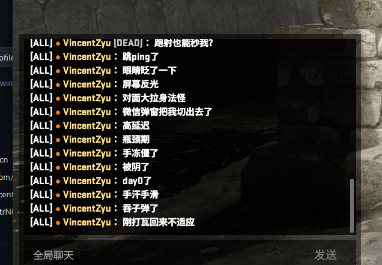
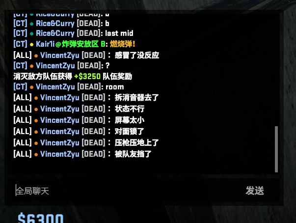
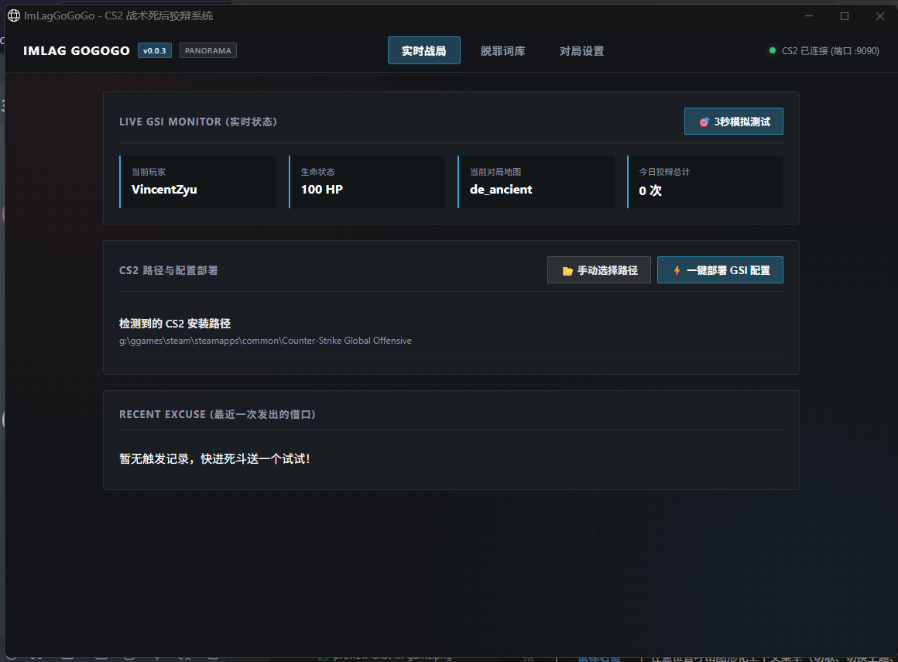

# ImLagGoGoGo 🎮

**🎮 CS2死后全自动狡辩工具 (Go 重构版) ⚡ 极轻量、纯静态单文件 🚀**

[-blue)](https://github.com/VincentZyu233/ImLagGoGoGo)

---

## 📸 界面与实机预览 (Screenshots)

### 🎮 游戏内公屏狡辩实况 (实录 1)
*“跑射也能秒我？跳ping了！眼睛眨了一下！微信弹窗把我切出去了...”*

 

### 🎮 游戏内公屏狡辩实况 (实录 2)
*“感冒了没反应！拆消音器去了！状态不行！屏幕太小！对面锁了...”*

 

### 🖥️ CS2 原生战术沉浸风控制面板
*原生还原 CS2 Panorama 暗黑战术网格与青蓝微光风格，纯静态零外部依赖。*

---

## 📌 项目灵感与致谢 (Upstream Reference)

本项目是基于著名开源项目 [**cneicy/ImLag**](https://github.com/cneicy/ImLag)（*“CS2死后全自动狡辩工具”*）理念的全新 Go 语言现代重构版本。

致敬原版作者 **Eicy** 及上游社区贡献者们带来的绝妙创意！在继承上游“死后自动发借口”核心精髓的基础上，本项目针对日常开黑与竞技对局中的诸多痛点进行了全方位深度重构与升级。

---

## ✨ 核心特性

- ⚡ **双模式智能狡辩架构 (CFG模式默认开启)**：
  - **方案 A (原生 CFG 模式，默认推荐)**：程序自动为 CS2 部署原生 `say` 别名轮换链，阵亡后程序仅在底层轻触冷门单键（默认 `K` 全局、`L` 队内），由 CS2 引擎自己向公屏打出借口。**完全不弹聊天框、不抢剪贴板、彻底免疫一切输入法与窗口焦点丢失！**
  - **方案 B (模拟输入模式)**：基于 `keybd_event` 扫描码 + 剪贴板粘贴回车，满足偏好视觉打字效果的玩家。
- 🚀 **极低资源开销**：基于 Go 原生开发，常驻后台内存仅 **~15MB**，对 CS2 竞技帧率完全零干扰。
- 🎯 **CS2 Panorama 原生战术沉浸风 UI**：精心还原 CS2 游戏内原生设置页面的碳黑网格质感与青蓝微光设计，就像把游戏内嵌菜单搬到了桌面。
- 🎴 **洗牌池抽样 (Shuffle Deck)**：独创无放回随机洗牌算法，一整套词库借口全部说完前绝不连发重复词，拒绝当“复读机”。
- ⏱️ **555ms 死亡拟真延迟缓冲**：死后智能微停顿 555ms，避开游戏死亡特写与按键惯性，体感逼真不吞键。
- 🔌 **智能 GSI 端口冲突避让**：默认 9090 (gogo) 端口被占时，自动顺延探测（9090 ~ 9099）并全自动重写 CS2 配置，用户完全零感知。
- 📂 **Steam 库全盘自动寻路**：全自动递归 Steam 多硬盘游戏库部署 GSI 与 CFG 借口链，亦支持通过系统弹窗手动指定 CS2 路径。
- 📝 **文本词库自动热监听 + 智能编码嗅探**：支持记事本直接修改 `Messages.txt`，保存瞬间自动无感生效；内置编码嗅探，自动适配 UTF-8 / GBK / ANSI，绝不出现乱码。

---

## 🛠️ 快速开始

### 1. 下载即用
从 [Releases 页面](https://github.com/VincentZyu233/ImLagGoGoGo/releases) 下载最新的绿色便携压缩包，解压后双击 `imlag-gogo.exe` 即可运行。

### 2. 初始配置
首次运行会在同级目录下自动生成 `config.toml` 与 `Messages.txt`：
- **`config.toml`**：填写您的 SteamID64（推荐，前往 [steamid.io](https://steamid.io) 即可查询）或昵称。
- **`Messages.txt`**：一行一条添加你喜欢的借口语句。

点击界面顶部的 **【一键安装 GSI 到 CS2】**，随后启动 CS2 进入对局即可尽情对线！

---

## 📜 许可证

本项目遵循 [MIT License](LICENSE) 开源协议。
