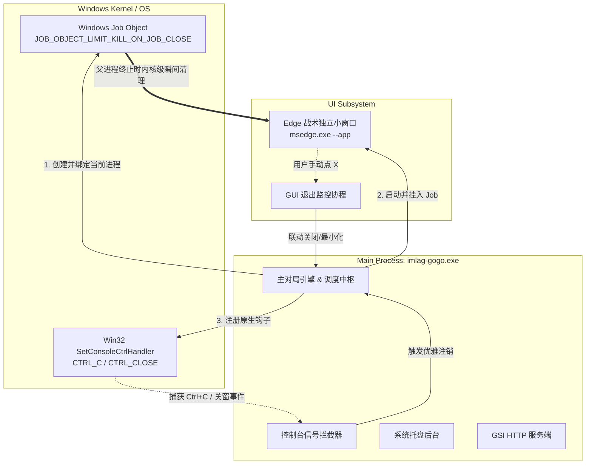

# ImLagGoGoGo 进程生命周期优化与单一版本源 (SSOT) 综合实施方案

> **文件路径**: `docs/dev/20261103.优化声明周期.还有版本号唯一来源.plan.md`  
> **实施版本**: `v0.0.4-beta.1`  
> **核心目标**:
> 1. **单一事实源 (SSOT) 版本管理**：全工程只在 Go 常量维护唯一版本号，HTML 模板动态注入、API 动态下发、CI 强校验防呆。
> 2. **进程与窗口生命周期综合管理**：解决终端 `Ctrl+C` 中断失效、PowerShell 非阻塞返回提示符、主进程退出后 Edge 独立战术窗口孤儿残留等系统级问题。

---

## Part 1. 单一事实源 (SSOT) 版本管理体系

### 1. 唯一源头：Go 代码常量
整个工程仅在 `internal/config/config.go` 中维护版本常量：
```go
const Version = "0.0.4-beta.1"
```
其余任何文件（YML、HTML、脚本）不再硬编码任何写死的版本号。

### 2. 前端双重保险：服务端模板注入 + API 动态绑定
* **服务端动态模板注入（零延迟无闪烁）**：
  * 在 `internal/ui/assets/index.html` 中使用语义化占位符：
    ```html
    <span class="header-badge" id="app-version">{{.Version}}</span>
    ```
  * 在 `internal/ui/server.go` 提供 HTML 服务时，Go 服务端在发送前统一替换为当前版本 `v` + `config.Version`；浏览器加载即呈现真实版本，绝无任何文字闪跳。
* **`/api/state` 动态数据兜底**：
  * 在实时战局轮询接口 `/api/state` 返回的 JSON 中同步携带 `"version": "v" + config.Version`，前端脚本同步更新。

### 3. CI/CD 流水线 (build.yml) 严格提取与 Tag 交叉防呆
* **正则严密提取**：通过正则 `const\s+Version\s*=\s*"([^"]+)"` 动态从 Go 代码提取版本号，写入环境变量 `APP_VERSION`。若匹配失败或为空，直接中断并 `exit 1`。
* **Tag 交叉拦截**：在发布 Release 时校验 Git Tag 与 Go 代码内版本是否 100% 吻合，防止版本号不一致导致错误发布。

---

## Part 2. 进程与窗口生命周期管理架构 (v0.0.4-beta.1)

### 1. 现场故障现象与根因深度剖析

#### 1.1 现象复盘
在 PowerShell 终端启动 `.\imlag-gogo.exe` 后：
```text
PS D:\aaaStuffsaaa\from_git\github\ImLagGoGoGo\dist> ^C26/11/03 15:19:57 ⚠️ [前台拦截] ...
PS D:\aaaStuffsaaa\from_git\github\ImLagGoGoGo\dist> ^C
PS D:\aaaStuffsaaa\from_git\github\ImLagGoGoGo\dist> ^C(方案 A: 原生 CFG 模式)
```
- PowerShell 在启动瞬间打印下一行提示符，并未阻塞等待程序。
- 随后程序的日志持续冲刷控制台屏幕。
- 用户尝试在控制台连续按 `Ctrl+C`，不仅程序没有退出，Edge 独立 App 窗口也依然存活在屏幕上。

#### 1.2 根因一：Windows PE 子系统标志 `-H=windowsgui` 导致的脱钩
- 项目构建脚本使用 `-ldflags="-H=windowsgui"`，生成的是 GUI 子系统（`IMAGE_SUBSYSTEM_WINDOWS_GUI`）可执行文件。
- **Windows 控制台规范**：CMD / PowerShell 在启动一个 GUI 程序时，会认定该程序不需要控制台输入输出，因此**异步拉起子进程后立刻返回**，让用户继续在控制台输入下一条命令。
- 随后程序在 Go 代码中调用了 `ui.EnsureConsole()` -> `AttachConsole(ATTACH_PARENT_PROCESS)`，将标准输出句柄强行绑定到父控制台的 `CONOUT$`。
- **`Ctrl+C` 失效的致命原因**：此时控制台的前台进程是 PowerShell 本身，控制台的 `CTRL_C_EVENT` 仅由 PowerShell 处理（即清空当前行并换行打印 `^C`）。`imlag-gogo.exe` 并不在控制台前台作业组中，标准 Go 运行时的 `signal.Notify` 根本接收不到任何信号！

#### 1.3 根因二：Edge 进程作为无约束的孤儿进程（Orphan Process）
- `internal/ui/window_windows.go` 中通过 `exec.Command("msedge.exe", "--app=...", ...).Start()` 启动了 Edge 独立应用窗口。
- 该进程启动后被立刻“遗弃”，未保存 `cmd.Process` 引用，也没有绑定生命周期守护机制。
- Windows 默认不会在父进程终止时杀死子进程。因此，即使后续主进程被终止或崩溃，Edge 窗口依然作为独立进程常驻系统。

---

### 2. 总体架构设计与解决方案



---

### 3. 四大核心模块技术实现

#### 模块 A：Windows 内核级 Job Object 强绑定（防孤儿兜底）
- **实现文件**：`internal/ui/job_windows.go`
- **实现原理**：
  1. 调用 `CreateJobObjectW` 创建专属作业对象。
  2. 配置 `JobObjectExtendedLimitInformation`：
     - 设置 `LimitFlags = JOB_OBJECT_LIMIT_KILL_ON_JOB_CLOSE (0x00002000)`。
  3. 将当前进程及子进程显式分配至 Job Object。
- **收益**：
  - **硬件级可靠性**：哪怕主程序遇到非法内存访问崩溃、被任务管理器强杀，Windows 操作系统内核会在句柄引用归零时，**毫秒级强制销毁 Job 内的所有子进程**。Edge 窗口必随之关闭，绝无孤儿进程残留。

#### 模块 B：原生 Win32 `SetConsoleCtrlHandler` 控制台拦截
- **实现文件**：`internal/ui/console_windows.go`
- **实现原理**：
  - 绕过 Go 运行时标准库对附加控制台支持不全的问题，直接通过 `kernel32.dll` 注册 `SetConsoleCtrlHandler`。
  - 拦截信号类型：`CTRL_C_EVENT (0)`、`CTRL_BREAK_EVENT (1)`、`CTRL_CLOSE_EVENT (2)`。
- **处理动作**：
  - 当接收到中断事件时，通过 `exitChan` 触发主引擎优雅注销，主动关闭 Edge 窗口、停止 GSI 服务器并退出。

#### 模块 C：双模发行与终端前台阻塞
- **构建输出优化**（`scripts/build.py`）：
  1. `imlag-gogo.exe`：GUI 子系统（`-H=windowsgui`），用于日常桌面双击启动，无 CMD 黑框打扰。
  2. `imlag-gogo-cli.exe`：控制台子系统，用于终端前台调试与交互，PowerShell/CMD 自然前台阻塞并实时捕获 `Ctrl+C`。
  3. `imlag-gogo.cmd`：便捷启动批处理，优先使用 cli 版本拉起。

#### 模块 D：Edge 战术窗口双向生命周期管理
- **实现文件**：`internal/ui/window_windows.go`
- 保存 `cmd.Process` 引用，提供 `CloseNativeWindow()`。
- 主动监听 `cmd.Wait()`，当用户点击窗口右上角 `[X]` 时与主程序状态同步。
- 当主程序收到退出指令（无论来自托盘菜单、控制台 Ctrl+C 还是系统关机）时，主动优雅终止该进程。

---

## 4. 实施阶段与交付清单

- [x] **Stage 1 (SSOT)**: 统一版本唯一事实源至 `internal/config/config.go`，并在 HTML 动态注入及 CI/CD 中落地。
- [x] **Stage 2 (Job Object)**: 新建 `internal/ui/job_windows.go` 与 `internal/ui/job_linux.go`，内核级强绑定进程树。
- [x] **Stage 3 (Console Handler)**: 新建 `internal/ui/console_windows.go` 与 `internal/ui/console_linux.go`，底层接管控制台中断。
- [x] **Stage 4 (Lifecycle Link)**: 重构 `internal/ui/window_windows.go` 与 `cmd/imlag/main.go`，接入统一退出通道 `exitChan`。
- [x] **Stage 5 (Dual Build)**: 更新 `scripts/build.py`，同步生成 `imlag-gogo.exe`、`imlag-gogo-cli.exe` 与 `imlag-gogo.cmd`。
- [x] **Stage 6 (v0.0.4-beta.2 Single Binary & Edge Profile Isolation)**:
  - 启动参数加入 `--user-data-dir` 独立沙箱 Profile，彻底打破 Chromium 全局单例委托，确保 Edge 窗口 100% 运行在 Go 的子进程树与 Job Object 约束下。
  - 接入 Win32 原生 `WM_CLOSE` + `cmd.Process.Kill()` + `Job Object` 三重关闭保险。
  - 统一全工程为真正的单一二进制 `imlag-gogo.exe`，废弃所有 cli/cmd 杂项。
  - 接入 `GetConsoleProcessList` 智能感知：终端中运行自动前台阻塞并捕获 Ctrl+C，双击运行首毫秒自动隐去黑框。
  - GitHub Actions 流水线直出纯 `imlag-gogo.exe` 发布资产，支持免解压极简运行。
